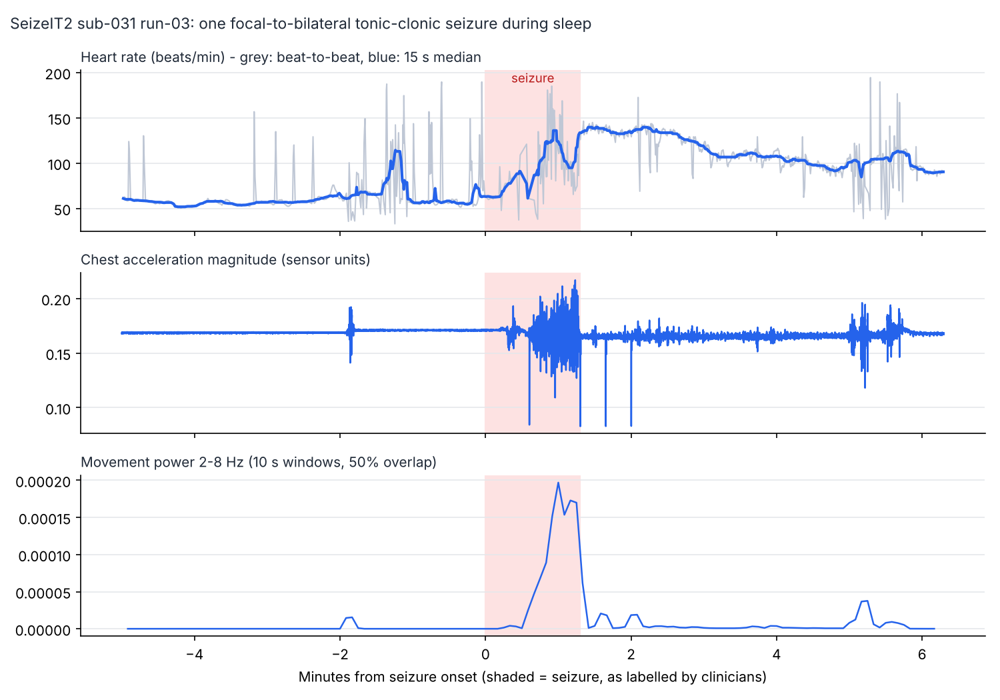

# seizure-guard (working name)

> **We do not predict seizures. We detect them, and get a person to the patient's side.**
> Research prototype for the AI for Medicine Hackathon. **Not a medical device.**

An open-source phone app for people with epilepsy who live alone. It watches movement (and
heart rate where available) during sleep, uses a seizure profile entered by the doctor to set
personal alarm rules, lets the patient say a private code word when they feel an aura, and
sends a location message to chosen contacts if they do not answer an "Are you OK?" countdown.

*Status: day 1 of development. Sections marked TODO will be filled with held-out results.*

## The problem

- Epilepsy affects around 50 million people worldwide, and about 5 million are diagnosed each year [1].
- Generalized tonic-clonic seizures (GTCS), and frequent GTCS, are among the factors most strongly
  associated with sudden unexpected death in epilepsy (SUDEP); nocturnal seizures may also increase
  risk [2].
- The presence of another person in the bedroom is *associated* with a lower SUDEP risk. The
  AAN/AES guideline says clinicians may advise selected patients with frequent GTCS and nocturnal
  seizures to use nocturnal supervision or other precautions, such as a remote listening device
  (Level C, the weakest recommendation level) [2]. The same guideline notes that night-time
  observation can be "overly burdensome and intrusive".
- People who live alone have no one in the room. Existing alternatives (medical watches,
  subscriptions, seizure dogs) cost money that many patients do not have.

**What we claim and what we do not.** We try to make a night-time precaution cheap and open
source: detect a probable convulsive seizure and get a person to check on the patient. We do
**not** claim the app prevents SUDEP; no study has tested that for this app.

## Quick start (reproduce)

```bash
python -m pip install --user -r requirements.txt
python src/download_data.py --labels             # seizure labels for all 125 patients (~3 MB)
python src/make_split.py                         # locks the patient-level test set (seed 42)
python src/download_data.py --sub 031 --run 03   # one night of ECG + motion (~80 MB)
python src/plot_seizure.py                       # -> results/seizure_sub-031_run-03.png
```

## Data

SeizeIT2 (OpenNeuro ds005873 v1.1.0, CC0): 125 patients, 883 annotated seizures,
~11,600 hours of wearable recordings from 5 European epilepsy monitoring units.
We use the single-lead ECG (256 Hz) and the 3-axis accelerometers (25 Hz) of the chest and
neck sensors. Seizure labels come from video-EEG review by clinicians.



*A held-out test patient (sub-031): a focal-to-bilateral tonic-clonic seizure during sleep.
Heart rate rises from a median of 58 to ~140 beats/min, and 2-8 Hz movement power is about
100x the level of the minutes before. This figure was used only for visual inspection; no
threshold was tuned on this patient.*

## Evaluation protocol (fixed before any modelling)

- **Patient-level split**, seed 42, stratified by whether a patient had a tonic-clonic (f2b)
  seizure: 94 train patients (707 seizures, 44 f2b) / 31 test patients (176 seizures, 11 f2b).
  Saved in `configs/split.json`. Test patients are never used for training or tuning;
  the final test is run once.
- Windows: 10 s, 50 % overlap.
- Metrics: sensitivity per seizure (%), false alarms per 24 h, detection latency (s),
  reported per seizure type and asleep vs awake, with patient-level bootstrap 95 % CIs.
- Baselines: motion threshold only, heart rate only, motion + heart rate.
- TODO: results tables.

## Limitations (known on day 1)

- Most SeizeIT2 seizures are focal; the app's main target (nocturnal tonic-clonic seizures)
  is only 55 of 883 events (11 in our test set), so those confidence intervals will be wide.
- Recorded in hospitals, with sensors on the chest and the back of the neck. A phone on a
  mattress or a wrist watch sees different signals. Not validated at home.
- Motion artefacts corrupt beat-to-beat heart rate during convulsions (see grey trace above).

## Who benefits, and who could be harmed

TODO

## With another month

TODO (e.g. emergency-number integration, home validation study, wrist-sensor data)

## References

1. World Health Organization. Epilepsy fact sheet. https://www.who.int/news-room/fact-sheets/detail/epilepsy
2. Harden C, Tomson T, Gloss D, et al. Practice guideline summary: Sudden unexpected death in
   epilepsy incidence rates and risk factors. *Neurology* 2017;88(17):1674-1680.
   doi:10.1212/WNL.0000000000003685
3. SeizeIT2 dataset, see [ATTRIBUTION.md](ATTRIBUTION.md).

## AI use

TODO
